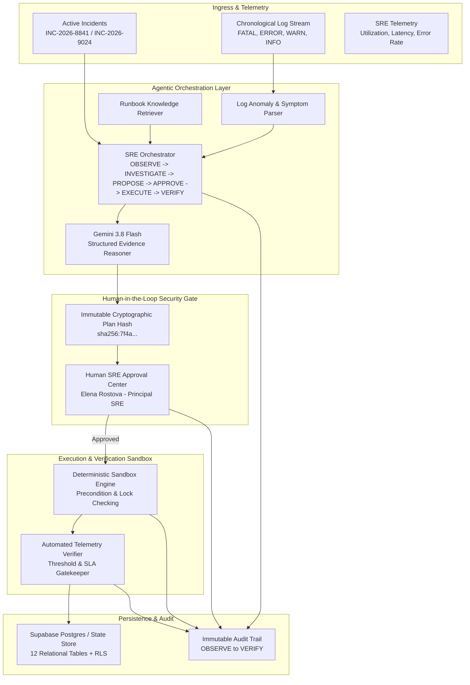

# IncidentIQ AI — Enterprise AI Incident Resolution Agent

> **Detect. Investigate. Approve. Remediate. Verify.**  
> Built for the Agentic AI Hackathon 2026.

**IncidentIQ AI** is an autonomous Site Reliability Engineering (SRE) incident resolution platform. It correlates live error logs, telemetry metrics, and troubleshooting runbooks to diagnose high-severity incidents, rank evidence-backed root-cause hypotheses, propose reversible remediation actions, enforce cryptographic human approval, execute fixes in an isolated sandbox, and deterministically verify service recovery.

---

## 1. System Architecture



---

## 2. Design System & Visual Identity

The interface is modeled after a mission-critical industrial operations center and SRE command room.

- **Main Backgrounds**: Deep Graphite (`#171916`), Dark Charcoal (`#20231F`), Elevated Charcoal (`#292C26`), Raised Surface (`#32352E`)
- **Borders & Dividers**: Graphite Border (`#41443B`), Subtle Divider (`#363931`)
- **Primary Brand Accent**: Burnt Orange (`#D97736`), Deep Copper (`#A95627`)
- **Secondary Accent**: Industrial Amber (`#E6B450`), Soft Amber (`#F2CD78`)
- **Recovery & Success**: Muted Teal (`#5C9E86`), Deep Teal (`#326B58`)
- **Text Palette**: Off-white text (`#E9E5DA`), Secondary (`#B4B3A7`), Muted (`#85877C`)
- **Strict Guardrails**: Blue and purple are strictly avoided as dominant themes, and cards never use stark white backgrounds.

---

## 3. Supported Incident Scenarios

### Scenario A: Database Connection Pool Exhaustion (`INC-2026-8841`)
- **Service**: `auth-payment-gateway`
- **Severity**: `CRITICAL`
- **Observed Symptoms**: Pool saturation reaches 98.4%, 342 connection acquisition timeouts, p99 latency spikes to 4,820ms, `/ready` health probe returns HTTP 503.
- **Root Cause**: Client pool starvation exacerbated by 8 leaked `idle-in-transaction` connections older than 180 seconds.
- **Approved Remediation**: `SIMULATE_INCREASE_CONNECTION_POOL` (expand ceiling to 50) and `SIMULATE_RELEASE_STALE_CONNECTIONS`.
- **Telemetry Verification**: Pool utilization drops to 42%, acquisition timeouts clear to 0, p99 latency stabilizes at 180ms, `/ready` probe returns `HEALTHY`.

### Scenario B: HTTP 500 Spike Post-Config Deployment (`INC-2026-9024`)
- **Service**: `edge-routing-service`
- **Severity**: `HIGH`
- **Observed Symptoms**: HTTP 500 error rate spikes to 28.6% immediately following canary deployment `rev-2026.4.19b`.
- **Root Cause**: `ConfigValidationError` due to missing required schema parameter `upstream_retry_budget_ms`.
- **Approved Remediation**: `SIMULATE_RESTORE_KNOWN_GOOD_CONFIG` targeting verified baseline `rev-2026.4.18-stable`.
- **Telemetry Verification**: Error rate drops to 0.02%, health checks return `HEALTHY`, active config version matches `rev-2026.4.18-stable`.

---

## 4. Key Security & Agentic Principles

1. **Evidence Citation Integrity**: Every ranked hypothesis links directly to verified stored log IDs (`LOG-xxx`) and runbook IDs (`RBK-xxx`). The agent never hallucinates nonexistent log events.
2. **Cryptographic Plan Hash Binding**: Proposals generate an immutable SHA-256 fingerprint of all action parameters and verification criteria. If the proposal is altered between review and execution, execution is blocked immediately.
3. **Mandatory Human-in-the-Loop**: Automated remediation cannot run without explicit operator sign-off in the Approval Center.
4. **Idempotency & Duplicate Execution Guards**: Completed or rejected proposals cannot be re-executed inadvertently.
5. **Deterministic Sandbox Isolation**: Predefined simulator actions only (`SIMULATE_INCREASE_CONNECTION_POOL`, `SIMULATE_RELEASE_STALE_CONNECTIONS`, `SIMULATE_RESTORE_KNOWN_GOOD_CONFIG`, `SIMULATE_RESTART_HEALTHY_SERVICE`). No arbitrary shell commands.
6. **Honest Recovery Verification**: Remediation execution does not blindly claim recovery. Before and after telemetry is measured against strict SLAs. If conditions fail, status is honestly flagged as `RECOVERY_FAILED`.

---

## 5. Environment Variables & Setup

### Environment Variables (`.env`)
```bash
# Gemini AI (Server-side only)
GEMINI_API_KEY="AIzaSy..."
GEMINI_MODEL="gemini-3.8-flash"

# Server Configuration
PORT=3000
NODE_ENV="development"

# Supabase PostgreSQL (Optional: live persistent storage)
SUPABASE_URL="https://xyzcompany.supabase.co"
SUPABASE_SECRET_KEY="eyJhbGciOi..."

# Frontend Supabase Config
VITE_SUPABASE_URL="https://xyzcompany.supabase.co"
VITE_SUPABASE_PUBLISHABLE_KEY="eyJhbGciOi..."
```

### Installation & Run
```bash
# 1. Install dependencies
npm install

# 2. Run full-stack development server (Express + Vite)
npm run dev

# 3. Compile and build for production
npm run build

# 4. Start production server
npm start
```

---

## 6. Database Migrations & Schemas

The database schema is defined in `supabase/migrations/001_initial_schema.sql` and populated with `supabase/seed.sql`:
1. `profiles` — SRE operators and authentication roles
2. `incidents` — Unique incident tracking and telemetry snapshots
3. `incident_logs` — Structured logs with JSON metadata
4. `runbooks` — Synthetic verified standard operating procedures
5. `investigation_runs` — AI reasoning runs and model metadata
6. `investigation_hypotheses` — Ranked root causes with evidence links
7. `investigation_evidence` — Concrete log correlations
8. `remediation_proposals` — Immutable plan hash and parameters
9. `remediation_approvals` — Cryptographically bound human sign-offs
10. `remediation_actions` — Execution audit and before/after metrics
11. `verification_results` — SLA gatekeeper evaluation
12. `audit_events` — Immutable ledger of all lifecycle events

---

## 7. Automated Test Suite

An automated test suite (`src/tests/agent.test.ts`) verifies all 12 operational capabilities:
1. `TEST-01`: Incident Retrieval (Scenarios A & B)
2. `TEST-02`: Log Parsing & Anomaly Extraction
3. `TEST-03`: Runbook Symptom & Severity Retrieval
4. `TEST-04`: AI Investigation & Evidence-Backed Hypotheses
5. `TEST-05`: Plan Hash Tampering Rejection
6. `TEST-06`: Rejected Action Execution Prevention
7. `TEST-07`: Valid Human Approval & Cryptographic Hash Binding
8. `TEST-08`: Deterministic Sandbox Remediation Execution
9. `TEST-09`: Duplicate Execution Prevention
10. `TEST-10`: Telemetry Recovery Verification
11. `TEST-11`: Recovery Failure Honesty (Honest Reporting)
12. `TEST-12`: Comprehensive Audit Trail Logging

Run the test suite anytime directly from the UI by clicking **Run Tests** in the top navigation bar or sending `POST /api/tests/run`.

---

## 8. REST API Reference

| Endpoint | Method | Description |
| :--- | :--- | :--- |
| `/api/health` | GET | Health probe, Gemini model, and Supabase status |
| `/api/incidents` | GET | List all active sandbox incidents |
| `/api/incidents/:id` | GET | Fetch incident details, logs, proposals, verifications |
| `/api/incidents` | POST | Inject a synthetic incident |
| `/api/incidents/:id/logs` | GET | Retrieve chronologically sorted logs |
| `/api/runbooks` | GET | List available SRE runbooks |
| `/api/incidents/:id/investigations` | POST | Trigger AI investigation |
| `/api/investigations/:id` | GET | Get specific investigation run |
| `/api/incidents/:id/proposals` | GET | List remediation proposals for an incident |
| `/api/proposals/:id/approve` | POST | Submit cryptographic human approval |
| `/api/proposals/:id/reject` | POST | Reject a proposal with operator notes |
| `/api/proposals/:id/execute` | POST | Execute approved proposal in sandbox |
| `/api/incidents/:id/verification` | GET | Retrieve post-remediation verification scorecard |
| `/api/incidents/:id/audit` | GET | Incident-specific audit events |
| `/api/audit` | GET | Full organization audit ledger |
| `/api/sandbox/reset` | POST | Re-initialize sandbox state to pristine baseline |
| `/api/tests/run` | POST | Execute 12-test automated verification suite |

---

## 9. Known Limitations
- The remediation engine is intentionally restricted to an air-gapped deterministic sandbox and will never execute arbitrary shell commands or access external production infrastructure without human oversight.
- When live Supabase credentials are not provided in environment variables, the system automatically uses its high-fidelity in-memory state engine, maintaining full feature parity and instant responsiveness.
